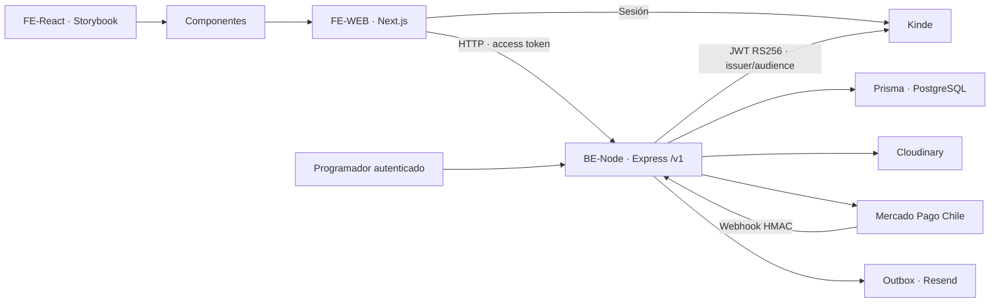

# Arquitectura · backend separado

FE-React contiene presentación reutilizable y Storybook. FE-WEB mantiene sesión Kinde, renderizado, formularios, caché de UI y adaptadores del servidor. `src/lib/backend` obtiene el access token de la sesión y llama a BE sin caché ni redirecciones, con tiempo acotado. No publica tokens ni claves de proveedores al navegador.

BE-Node verifica el JWT con JWKS, issuer, audience, RS256, expiración y sujeto. Resuelve el usuario mediante el perfil Kinde y aplica permisos de administrador, membresía y propiedad. No confía en IDs/roles enviados por FE. Un AsyncLocalStorage aísla el actor verificado durante cada solicitud; no hay variable global compartida de usuario. Las consultas premium se redactan antes de salir de BE.

BE es el único dueño de Prisma, migraciones, PostgreSQL, cálculos/estados de pagos, idempotencia, límites durables, webhooks, firmas Cloudinary, correo y cron. Los DTO HTTP usan fechas ISO y enteros CLP; FE no importa modelos generados Prisma. `npm run check:architecture` impide reintroducir SDK backend, acceso directo a datos o secretos en src de FE.

El antiguo `/api/sign-image` de FE es un adaptador autenticado para el widget. Las rutas antiguas de webhook Mercado Pago y cron devuelven 410: registrar las rutas directas de BE. Kinde mantiene sus rutas de login/callback/logout en Next.

Las carpetas y ramas son independientes. Solo FE-React/FE-WEB necesitan proximidad por el paquete local actual; BE se integra mediante BACKEND_API_URL y puede alojarse por separado. No se eligió proveedor de hosting ni se desplegó producción.
