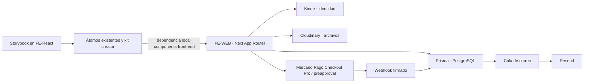

# Arquitectura

Las credenciales residen en FE-WEB. FE-React contiene presentación y no conoce la base, Mercado Pago, Kinde ni los roles. Las acciones del servidor validan identidad y permisos, y los datos premium se redactan antes de serializarse hacia React cliente. Las transacciones Prisma protegen recepción de eventos, pedidos, pagos y cola de email. Los likes tienen unicidad en base de datos y actualización serializable.

La relación local entre paquetes no comparte historias Git. Para desplegar, usar checkouts hermanos o publicar primero la versión correspondiente de la biblioteca. El workflow manual de FE-WEB recibe el ref publicado de FE-React; no funcionará con cambios que solo existen localmente.
